<div align="center">



<a href="https://github.com/Shashank23k"></a>

**Software development** &nbsp;·&nbsp; **Applied AI/ML** &nbsp;·&nbsp; **Algorithms & problem solving**

[Explore my projects](#-featured-builds) · [See my toolbox](#-my-toolbox) · [How I approach problems](#-engineering-mindset)

</div>

---

### 👋 About me  `> whoami`

I'm **Shashank K**, a computer science student specializing in **Artificial Intelligence**, with a developer's instinct to take an idea from *"what if?"* to *"it works."*

I like building at the intersection of **software engineering, intelligent systems, and practical problem-solving**. I enjoy debugging the hard parts, thinking through trade-offs, and turning working prototypes into software people can actually use.

- **Build:** backend utilities, full-stack experiences, and applied ML prototypes.
- **Solve:** data structures, algorithms, and the engineering decisions behind reliable systems.
- **Explore:** computer vision, federated learning, and real-world automation.

### ⚡ Featured builds

<table>
  <tr>
    <td width="50%" valign="top">
      <h3>⚙️ <a href="https://github.com/Shashank23k/FLAM-QueueCTL">FLAM-QueueCTL</a></h3>
      <p><b>Background job processing, built from the ground up.</b></p>
      <p>A Python job queue with concurrent workers, SQLite persistence, exponential-backoff retries, a dead-letter queue, priority scheduling, and a Flask monitoring dashboard.</p>
      <p><code>Python</code> <code>SQLite</code> <code>CLI</code> <code>Flask</code> <code>Systems</code></p>
      <a href="https://github.com/Shashank23k/FLAM-QueueCTL">Explore the architecture →</a>
    </td>
    <td width="50%" valign="top">
      <h3>🌱 <a href="https://agri-core-omega.vercel.app/">AgriCore</a></h3>
      <p><b>Building a product around agricultural workflows.</b></p>
      <p>An evolving web application focused on agriculture, bringing product thinking and frontend engineering into a practical problem space.</p>
      <p><code>Next.js</code> <code>React</code> <code>Web App</code> <code>In Progress</code></p>
      <a href="https://agri-core-omega.vercel.app/">Open live project →</a>
    </td>
  </tr>
  <tr>
    <td width="50%" valign="top">
      <h3>🧠 Federated Glaucoma Detection</h3>
      <p><b>Machine learning across non-IID medical datasets.</b></p>
      <p>Explored multi-client training, data heterogeneity and personalized federated learning approaches for retinal image classification.</p>
      <p><code>PyTorch</code> <code>Flower</code> <code>EfficientNet</code> <code>Federated Learning</code></p>
      <sub>Research project · public code link to be added</sub>
    </td>
    <td width="50%" valign="top">
      <h3>🔬 Histopathology Image Classification</h3>
      <p><b>Combining deep and handcrafted visual features.</b></p>
      <p>Studied multi-class colon histopathology using vision transformer embeddings, texture features and classical machine-learning models.</p>
      <p><code>Computer Vision</code> <code>ViT</code> <code>scikit-learn</code> <code>Feature Engineering</code></p>
      <sub>Research project · public code link to be added</sub>
    </td>
  </tr>
</table>

<details>
  <summary><b>More things I've built & explored</b></summary>
  <br />

  - **Full-stack blog platform** — Next.js, React, Clerk authentication and MongoDB.
  - **Weather and cricket pitch curation** — an IoT + Random Forest project combining sensor data and prediction.
  - **Algorithm practice** — implementation notebooks and exercises in <a href="https://github.com/Shashank23k/DAA">Design & Analysis of Algorithms</a>.

</details>

### 🛠️ My toolbox

**Languages**

 &nbsp; `SQL`

**Web & backend**


**ML & data**


**Development tools**


### 🧩 Engineering mindset

```yaml
approach:
  understand: "Start with the problem, not the framework"
  design:     "Make trade-offs explicit"
  implement:  "Keep it simple, then make it robust"
  debug:      "Follow evidence, not assumptions"
  improve:    "Refactor, measure, repeat"

interests:
  - reliable backend systems
  - applied machine learning and computer vision
  - data structures and algorithms
  - products people genuinely find useful
```

**Problem-solving isn't just about passing test cases.** For me, it's about understanding constraints, finding a clean approach, and knowing *why* it works. I practice DSA and apply the same structured thinking when working on systems and ML projects.

### 🐍 Contribution activity

<div align="center">

**A little game running across my real contribution history.**

<picture>
  <source media="(prefers-color-scheme: dark)" srcset="https://raw.githubusercontent.com/Shashank23k/Shashank23k/output/github-contribution-grid-snake-dark.svg" />
  <source media="(prefers-color-scheme: light)" srcset="https://raw.githubusercontent.com/Shashank23k/Shashank23k/output/github-contribution-grid-snake.svg" />
  
</picture>

<sub>Generated automatically from GitHub contributions. The graphic updates daily after the workflow is enabled.</sub>

</div>

---

<div align="center">

### Always curious. Always building.

If you're working on **interesting software, AI/ML, or developer tools**, take a look through the repositories and feel free to connect through GitHub.

<a href="https://github.com/Shashank23k?tab=repositories"></a>

<sub>Made with curiosity · Built to evolve</sub>

</div>

<!-- Optional: add verified LinkedIn and LeetCode profile links once available. -->